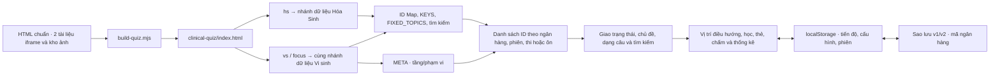

# D1–D2 · Kiến trúc và kiểm toán nguồn

Nền `develop` tại `c4668de7f189c8fff29f1fa65be1a3e6c86f32dd`. Tệp chuẩn theo [AGENTS.md](../AGENTS.md) là `nkhkjjhkkjjh.html`, SHA-256 `ed9205578d42b736ddc3d42d5e386b1521f597700b35aaef70dafc5640ac3123`. Nguồn kiểm toán là các literal JSON trong tệp này. Đối chiếu tài liệu [kiểm toán](../docs/AUDIT.md), [tính toàn vẹn](../docs/DATA-INTEGRITY.md), [giai đoạn 2](../docs/PHASE-2.md), [kế hoạch kiểm thử](../docs/TEST-PLAN.md), [tương thích](../docs/COMPATIBILITY.md), [3A](../docs/PHASE-3A.md), [3B](../docs/PHASE-3B.md) và [thiết bị thật](../docs/DEVICE-CHECKLIST.md).

- `hs` chạy nhánh Hóa Sinh trong literal `IS_VS ? ... : ...`. `vs` chạy nhánh Vi sinh, với `STRATEGIC` điều khiển phạm vi. Cả hai iframe nhúng cả hai ngân hàng. Nhánh Vi sinh không hoạt động trong `hs` có 495 bản ghi, thiếu 407, 431, 443, 448, 450 trong cả câu hỏi, khóa và chủ đề. Bản Hóa Sinh sao chép trùng theo ID. Trang `index.html` gốc là ứng dụng Vi sinh riêng. Đối chiếu tại SHA nền cho thấy nhánh Vi sinh của trang đó trùng các literal câu, khóa, chủ đề, tầng và alias nguồn với nhánh Vi sinh đang dùng trong Clinical Quiz.
- ID nguyên dương được lưu sẵn, hiện trùng số thứ tự 1-based trong hai mảng đang dùng. Lookup dùng Map theo ID. Lớp điều hướng tính vị trí bằng danh sách ID hiện hành, nên kết quả lọc hoặc phiên đổi mẫu số. Năm alias trích dẫn Vi sinh chỉ định số tham chiếu nguồn, bao gồm 407 → 400. Chúng không mang nghĩa đổi ID tiến độ. Số thứ tự PDF của các câu còn lại chưa được xác minh.
- Khóa runtime lấy từ `KEYS`. Trường `QUESTIONS.answer` của Hóa Sinh đều null, gồm 288 câu có khóa ở bảng riêng. Vi sinh có trường inline đồng nhất với khóa runtime. Dạng nhiều đáp án được suy ra từ cờ, kiểu khóa hoặc cụm từ ở Hóa Sinh. `FIXED_TOPICS` điều khiển thực tế, các bảng regex và override cũ vẫn nằm trong HTML. UI tách chương bằng dấu ` › `. Vi sinh còn lặp nhãn chủ đề trong `META`; 500 nhãn của nhánh đang dùng khớp nhau.
- ID được chọn từ phiên, bài thi hoặc tập câu sai trước khi áp dụng bộ lọc. Một số dạng câu có giao nhau theo định nghĩa cũ như số lượng lựa chọn và một/nhiều đáp án. Trọng tâm là tầng 1–3, với tầng 4 chia A–D. Lớp phạm vi chiến lược sắp thứ tự theo tầng, nhóm và ID, và xử lý thi bằng nhánh riêng. Tìm chuỗi số dùng ID, trong khi số hiển thị có thể là vị trí. `all`, mã scope và `vi-sinh-495` là giá trị tương thích được hardcode. Album 12 JPEG được khai báo ở cả hai iframe và dùng cùng một kho byte ở trang vỏ.
- Tiến độ Vi sinh thường và trọng tâm dùng chung `mcq_vs_multi1`, Hóa Sinh dùng `mcqhs2_v5`; bản Clinical Quiz thêm tiền tố `clinical-quiz:`. Phiên luyện Vi sinh phân biệt normal/focus, snapshot học/ôn cũ lại có thể dùng chung. Các phiên thiếu scope không đủ dữ kiện để suy ra ý định. Khóa lưu tiến độ, ID và nhãn chủ đề là phụ thuộc trực tiếp của migration.

## Kết quả nguồn

Báo cáo [quality.json](v1/quality.json) liệt kê số lượng, tầng, chủ đề một câu, các chênh lệch bản sao và khóa thiếu. Dữ liệu hoạt động có 796 ID theo ngân hàng, 388 trọng tâm và 112 bổ sung. Mười câu thiếu khóa và ba câu thiếu lựa chọn khớp kiểm toán trước. Khóa hiện hữu tham chiếu hợp lệ đến lựa chọn. Vi sinh có 24 giải thích. Các nhãn Hóa Sinh kiểu `Chương 2 · Glucid` và `Glucid` đang tồn tại song song, cần thẩm định nguồn trước khi hợp nhất.

Có năm nhóm trùng nguyên văn câu hỏi và danh sách lựa chọn. Hai nhóm có khóa khác nhau, Hóa Sinh 82/83 (A/C) và Vi sinh 424/428 (D/A). Các ID giữ riêng để không nhập nhầm tiến độ. Ba nhóm Vi sinh còn lại có alias trích dẫn ở một phía. Việc xác minh khóa và nhãn cần tài liệu nguồn. Tìm thấy cấu trúc xung đột, chưa xác định khóa nào đúng.

## ID 497

ID 497 ánh xạ duy nhất đến `vi-sinh:497`. Tầng 1, nhóm 1, topic `Virus học › Cúm và HIV`. Chủ đề có 492/495/497/499 trong toàn bộ ngân hàng và 497/499 trong trọng tâm. Giao thêm tầng 1 hoặc tìm chính xác ID có thể cho một câu hợp lệ. Phiên đã lưu `[497]` cũng cho một câu vì điều hướng bị giới hạn bởi danh sách phiên.

Báo cáo 3B tái hiện đường logic phần mềm với 387/388 câu đã trả lời, dùng shortcut chưa trả lời để tạo phiên `[497]`. Kết quả dữ liệu ở SHA nền xác nhận không có ID mồ côi, sai tầng hay quan hệ chủ đề tạo riêng ca đó. Hiện tượng trên Safari thiết bị thật vẫn cần chứng cứ của phiên cụ thể. Các bản sao và việc dùng chung snapshot đời cũ là rủi ro kiến trúc độc lập với ca đã tái hiện.
