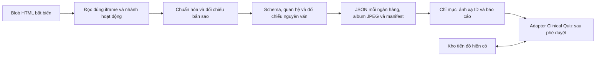

# D3–D6 · Kiến trúc dữ liệu, contract và chuyển đổi

## TO-BE



JSON đủ cho quy mô 796 câu, tải tĩnh và chạy offline. Mỗi môn có một bản ghi cho mỗi ID. Bản trọng tâm là view của Vi sinh, lấy theo `priority.tier ∈ {1, 2, 3}`. View bổ sung là tầng 4. Chỉ mục lưu danh sách ID dẫn xuất để tra nhanh. Khi có chênh lệch, tái tạo chỉ mục từ ngân hàng và chạy kiểm định. Bản chuẩn HTML vẫn là đầu vào bất biến và là nền để kiểm chứng v1. Sau khi được duyệt, ứng dụng đọc gói phiên bản JSON làm nguồn nội dung runtime.

## Data Dictionary

| Thực thể | Trường/quan hệ | Quy ước |
| --- | --- | --- |
| Dataset Version | `manifest.json`, `schemaVersion`, `datasetVersion`, `sourceCommit`, `sha256` | Hợp đồng cấu trúc và bản phát hành dữ liệu có phiên bản riêng. Hash các tệp JSON trong manifest, hash JPEG trong danh mục media. |
| Question Bank | `bankId`, `backupBank`, `questions`, `views`, `taxonomy`, `album`, `source` | `hoa-sinh-2`, `vi-sinh`. View `all` có giá trị null, các view con liệt kê tầng hợp lệ. |
| Question Identity | `id`, `localId`, `identity.json` | ID toàn cục là chuỗi `bankId:localId`. ID di sản là số nguyên trong namespace của ngân hàng. JSON key dạng chuỗi là cách biểu diễn của object. |
| Question | `prompt`, `multi`, `kind`, `topicId`, `priority`, `tags` | Nội dung gốc. `multi` theo runtime cũ. `kind` là giá trị gốc hoặc null. |
| Answer Options | `options[]` gồm `label`, `text` | Giữ chữ, thứ tự và nhãn. Mảng rỗng là tình trạng thiếu ở nguồn. |
| Answer Key | `answerKey` | Mảng nhãn lựa chọn theo thứ tự khóa nguồn hoặc null. Khóa null không được chấm điểm. |
| Explanation | `explanation` | Object nguyên văn với trường nguồn hoặc null. |
| Media Asset | `album[].assetId` → `media.json` | Album giữ nhãn, alt, tiêu đề và thứ tự. Danh mục chỉ đến JPEG bằng SHA-256, có byte length, MIME và chỉ số kho ảnh nguyên bản. |
| Source Metadata | `source`, `sourceNumber`, `sourceExcerpt` | Nguồn blob, commit, checksum và frame ở cấp ngân hàng. Số trích dẫn alias và trích đoạn gốc tùy ID. Null biểu thị chưa có giá trị nguồn để xác nhận. |

## Taxonomy Dictionary

Danh mục cụ thể nằm trong `taxonomy` của [Hóa Sinh 2](v1/hoa-sinh-2.json) và [Vi sinh](v1/vi-sinh.json). Báo cáo [quality.json](v1/quality.json) cung cấp số câu theo từng nhãn.

- **Chapter** lưu nhãn phần đứng đầu của phân loại đang dùng. **Topic** có `chapterId`, `label`, `legacyLabel`. Nguồn phân loại hoạt động có hai cấp. Mục trung gian chỉ được thêm trong phiên bản schema mới nếu có dữ liệu nguồn rõ ràng. Chủ đề mang cùng tên dưới các chương khác nhau có ID riêng.
- **Priority Tier** có 1, 2, 3 cho trọng tâm và 4 cho bổ sung. **Group** có chuỗi 1/2/3 và 4A/4B/4C/4D. `flag` và `reason` giữ giá trị nguồn. `priority: null` dùng cho Hóa Sinh 2. Các bộ lọc chương, chủ đề và tầng giao nhau.
- **Tags** là danh mục độc lập. V1 có danh mục và quan hệ rỗng do nguồn đang dùng không định nghĩa thẻ độc lập. Giữ mã lý do trong `priority.reason`.
- ID chương/chủ đề v1 được dẫn xuất từ SHA-256 của nhãn, chỉ để nhập lần đầu. Mọi lần đổi nhãn cần giữ ID đã phát hành hoặc ghi bảng alias có kiểm thử. Không ghép chương Hóa Sinh gần nghĩa khi chưa xác minh.

## Hợp đồng cho Agent phần mềm

- Kiểm tra manifest, schema và checksum trước khi dựng ngân hàng. Đọc `questions` theo `localId` qua Map hoặc `id` toàn cục khi thao tác xuyên ngân hàng. [model.mjs](model.mjs) là schema thực thi và có hàm `indexBank`, `selectIds`, `resolveLegacyId`.
- `selectIds` lấy giao của view, chương, chủ đề, tầng, nhóm, kind, trạng thái có khóa, ID và danh sách ID phiên nếu được truyền. Mảng phiên rỗng trả về rỗng. Kết quả mặc định theo thứ tự dữ liệu, hoặc theo thứ tự phiên đầu vào. Với giao diện trọng tâm cũ, adapter áp dụng thứ tự tier, group, ID tại nơi chế độ yêu cầu. Hành vi tìm kiếm có/không dấu, chấm, dạng lọc dẫn xuất theo số lựa chọn và tiến độ do adapter ứng dụng giữ theo các ca hồi quy đã có.
- `localId` dùng để lưu và đọc tiến độ. `sourceNumber` dùng cho tham chiếu tài liệu. Index mảng là chi tiết bộ nhớ. Vị trí sau lọc và vị trí phiên được tính trên từng danh sách ID, 1-based chỉ để hiển thị. Nhãn hiển thị lấy từ từ điển hoặc ngôn ngữ của UI. Lưu `current` theo ID, tính mẫu số từ danh sách điều hướng.
- Adapter chuyển `answerKey: null` thành khóa thiếu. Khóa một lựa chọn được chiếu về chuỗi ở API cũ, khóa nhiều lựa chọn về mảng với cùng thứ tự. `KEYS` điều khiển chấm. Khi cần chiếu lại `QUESTIONS.answer`, dùng null cho Hóa Sinh 2, chuỗi hoặc null cho Vi sinh. `legacyLabel` vẫn hợp lệ trong `studyTopic`/`topicFilter`. Giữ nguyên `navigationVersion` và scope của bản ghi. Alias số nguồn Vi sinh là metadata trích dẫn, tuyệt đối giữ `vi-sinh:407` và ID 400 độc lập trong namespace Vi sinh.

## Migration và rollback

1. Ghi manifest đang dùng và bản sao chỉ đọc của các giá trị localStorage liên quan. Ghi riêng trạng thái trình duyệt gốc với tiền tố Clinical Quiz. Dùng cùng origin và namespace khi thử adapter. Backup schema 2 mang lịch ôn, kế hoạch, phiên học và phiên luyện normal/focus. Backup schema 1 thiếu các trường mở rộng, vì vậy giữ phần đang có trên thiết bị. Phiên thi đang chạy lấy từ kho cục bộ, backup ứng dụng không chứa phiên thi đang chạy.
2. Chạy adapter thử bằng fixture trước khi đổi đường đọc. Giữ ID số và mã `hoa-sinh-2-296`, `vi-sinh-495`. Ánh xạ đủ 796 ID trong [identity.json](v1/identity.json). Dùng bản v1/v2 và snapshot phiên cũ để so sánh đáp án, đánh dấu, câu sai, exam history, deadline, điểm, lịch ôn, planner, thẻ, current, thứ tự phiên, scope và nhãn chủ đề. Kho dữ liệu tiến độ của bản phát hành này không cần chuyển đổi hay ghi lại. Nếu gặp ID không tồn tại, ghi chẩn đoán và bảo toàn bản gốc để phục hồi, tránh trỏ theo index.
3. Sau khi gate đạt và được duyệt, Agent phần mềm chuyển đường đọc qua một điểm cấu hình, khóa manifest theo bản phát hành và chạy lại hồi quy Chromium/WebKit. Kiểm tra Safari thật nếu cần xác nhận ca 497 ngoài mô phỏng. Dừng phát hành nếu đối chiếu thay đổi câu, khóa hoặc tiến độ.
4. Rollback bằng manifest/adapter phiên bản trước hoặc quay lại đường đọc HTML chuẩn. Vì khóa và hình dạng lưu trữ tương thích, rollback đường đọc giữ được các lần học mới. Chỉ phục hồi bản sao localStorage khi có bằng chứng dữ liệu lưu bị hỏng và đã bảo toàn các cập nhật sau thời điểm sao lưu.

## Pipeline và bổ sung môn học

Dùng Node.js 22 trở lên. Thực hiện từ gốc repository.

```sh
node data-engineering/pipeline.mjs --export /tmp/clinical-quiz-review
node data-engineering/pipeline.mjs --verify data-engineering/v1
node --test --test-isolation=none data-engineering/quality.test.mjs tests/integrity.test.mjs
node data-engineering/pipeline.mjs --gate data-engineering/v1
```

`--export` yêu cầu thư mục đích mới, chỉ viết sau khi hoàn thành kiểm định cấu trúc, và ghi manifest cuối cùng. `--verify` xây lại từ nguồn và so từng byte của JSON và ảnh. Một thư mục thiếu manifest hoặc không qua `--verify` chưa đủ điều kiện bàn giao. Chạy `node scripts/build-quiz.mjs` nếu cần tạo lại HTML ứng dụng trước khi chạy bộ integrity cũ. `--gate` bổ sung kết quả chặn xung đột khóa. Lệnh hiện thoát 1 có chủ đích. Khi có bằng chứng và phê duyệt xử lý xung đột, ghi quyết định theo ID và SHA nguồn, tạo phiên bản gói mới và chạy lại toàn bộ gate. CI ứng dụng và cấu hình triển khai không thuộc bản thay đổi dữ liệu này.

Thêm môn bằng adapter nhập nguồn đã ghim SHA, khai báo mã ngân hàng/backup riêng, số ID dự kiến và phần thiếu đã kiểm toán. Duy trì ID đã cấp dù thứ tự nguồn thay đổi. Ánh xạ nhãn vào taxonomy, xây hoặc khai báo view, cung cấp media theo checksum, rồi chạy các ca schema, tham chiếu, bảo toàn nội dung, phân hoạch view và compatibility. Cập nhật manifest và phiên bản dataset sau khi so diff. Khai báo expected ID theo danh sách thực tế nếu ngân hàng mới có ID không liên tục.

## Bằng chứng kiểm định

Node 24.22.3 trên Linux tại SHA nền. Sáu kiểm thử dữ liệu và kiểm tra integrity hiện có đều đạt. Bản build ứng dụng tái tạo đúng blob Git `e97ffe86179610bcc9ffc059bfe0880bc2933219`. Verify so byte của dữ liệu phiên bản và đủ 12 JPEG. Gate tích hợp thoát 1 với đúng hai nhóm xung đột. Kiểm thử migration ở đây bao phủ lookup, hai dạng fixture và giữ nguyên dữ liệu đầu vào. Hồi quy trình duyệt của adapter là tiêu chí nghiệm thu sau khi adapter được xây. Bằng chứng trình duyệt trước đó nằm trong tài liệu 3B và giai đoạn 2.
